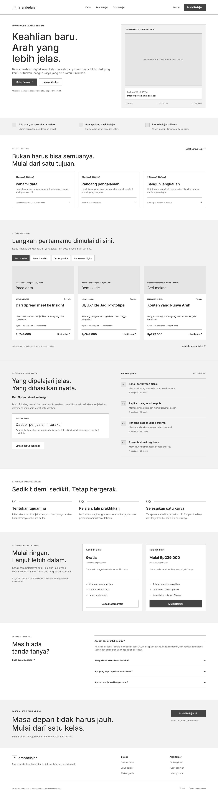
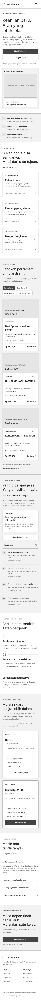
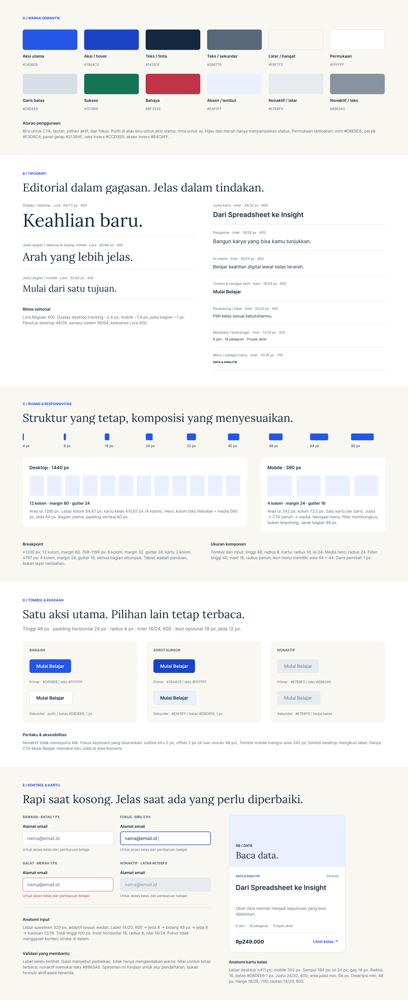
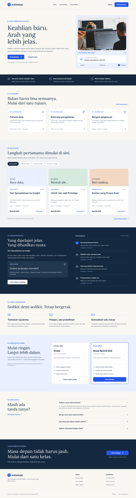
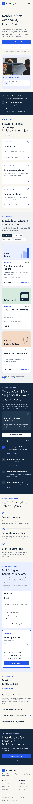

# Pertemuan 06 – Praktikum Desain Web

| | |
|---|---|
| **Nama** | Ridho Sachlan |
| **NIM** | 4525210066 |
| **Mata Kuliah** | Praktikum Desain Web |
| **Pertemuan** | 06 |
| **Studi Kasus** | ArahBelajar – platform belajar keahlian digital |

---

## Deskripsi Singkat

Pada pertemuan ini saya merancang halaman **Beranda** untuk *ArahBelajar*, sebuah konsep platform kelas keahlian digital (data & analitik, desain produk, pemasaran digital). Tahapan yang dikerjakan:

1. Membuat **wireframe** desktop dan mobile.
2. Menyusun **sistem desain mini** (warna, tipografi, ruang, tombol, kontrol, dan kartu).
3. Menerapkan keduanya menjadi **desain beranda** versi desktop (1440 px) dan mobile (390 px).

---

## Wireframe

### Wireframe Desktop

Wireframe desktop berukuran 1440 px dengan tata letak abu-abu (*low-fidelity*) untuk menentukan struktur dan hierarki konten sebelum diberi warna dan gaya visual. Elemen utama:

- Header: logo, menu (Kelas, Jalur belajar, Cara belajar), tautan Masuk, dan tombol **Mulai Belajar**.
- Hero dua kolom: judul, deskripsi, dua tombol aksi di kiri; placeholder foto dan kartu "Dari materi ke karya" di kanan.
- Strip tiga nilai jual, lalu bagian jalur belajar dalam tiga kartu.

### Wireframe Mobile

Wireframe mobile berukuran 390 px. Seluruh komponen disusun satu kolom (ditumpuk), menu navigasi diringkas menjadi ikon menu, dan tombol aksi dibuat selebar penuh agar mudah ditekan.

---

## Sistem Desain Mini

### Warna Semantik

| Peran | Kode |
|---|---|
| Aksi utama | `#2456E8` |
| Aksi / hover | `#1944C5` |
| Teks / tinta | `#14283F` |
| Teks / sekunder | `#586779` |
| Latar / hangat | `#F8F7F2` |
| Permukaan | `#FFFFFF` |
| Garis batas | `#D8DEE6` |
| Sukses | `#157456` |
| Bahaya | `#BF3545` |
| Aksen / lembut | `#EAF0FF` |
| Nonaktif / latar | `#E7EBF0` |
| Nonaktif / teks | `#8993A0` |

### Tipografi

- **Lora Regular 400** untuk judul (display dan judul bagian) agar terkesan editorial.
- **Inter** untuk antarmuka, isi, tombol, dan metadata.

| Gaya | Font | Ukuran / Tinggi baris | Bobot |
|---|---|---|---|
| Display (desktop) | Lora | 64/72 px | 400 |
| Judul bagian (desktop) | Lora | 40/48 px | 400 |
| Judul bagian (mobile) | Lora | 32/40 px | 400 |
| Judul kartu | Inter | 24/32 px | 600 |
| Pengantar | Inter | 18/28 px | 400 |
| Isi utama | Inter | 16/24 px | 400 |
| Tombol & navigasi aktif | Inter | 16/24 px | 600 |
| Pendukung / label | Inter | 14/20 px | 400 |
| Metadata / keterangan | Inter | 12/16 px | 400 |
| Mikro / kategori kartu | Inter | 10/16 px | 700 |

### Ruang & Responsivitas

- Skala jarak: 4, 8, 16, 24, 32, 40, 48, 64, 80 px.
- **Desktop 1440 px:** 12 kolom, margin 80, gutter 24 (area isi 1280 px).
- **Mobile 390 px:** 4 kolom, margin 24, gutter 16 (area isi 342 px).
- Breakpoint: ≥1200 px = 12 kolom; 768–1199 px = 8 kolom (margin 32, gutter 24); ≤767 px = 4 kolom (margin 24, gutter 16).
- Ukuran komponen: tombol dan input tinggi 48 px, radius 8; kartu radius 16, padding 24.

---

## Desain Beranda

### Beranda Desktop

### Beranda Mobile

### Perbedaan Desktop dan Mobile

| Aspek | Desktop (1440 px) | Mobile (390 px) |
|---|---|---|
| Grid | 12 kolom | 4 kolom |
| Navigasi | Menu terbuka di header | Ikon menu |
| Hero | Dua kolom (teks dan media) | Satu kolom; teks, tombol, lalu media |
| Tombol hero | Sejajar, lebar sesuai isi | Ditumpuk, lebar penuh |
| Kartu | Tiga kartu sebaris | Satu kartu per baris |
| Judul bagian | Lora 40/48 px | Lora 32/40 px |

---

## 6. Kesimpulan

Dengan memulai dari wireframe, lalu menetapkan sistem desain mini, desain akhir beranda menjadi konsisten pada warna, tipografi, jarak, dan komponen di desktop maupun mobile. Satu aksi utama (*Mulai Belajar*) dipertahankan sebagai satu-satunya tombol biru solid di area konversi agar alur pengguna tetap jelas.
